<div align="center">


</div>

```ts
const s5sa = {
  location: "Brooklyn, NY",
  role:     "developer",
  mode:     "ship first, polish after",
  focus:    ["interfaces", "motion", "things that feel alive"],
  status:   "online",
} as const;
```

<div align="center">


<br/><br/>


### contribution snake

<picture>
  <source media="(prefers-color-scheme: dark)" srcset="https://raw.githubusercontent.com/s5sa/s5sa/output/snake-dark.svg"/>
  <source media="(prefers-color-scheme: light)" srcset="https://raw.githubusercontent.com/s5sa/s5sa/output/snake.svg"/>
  
</picture>



</div>
